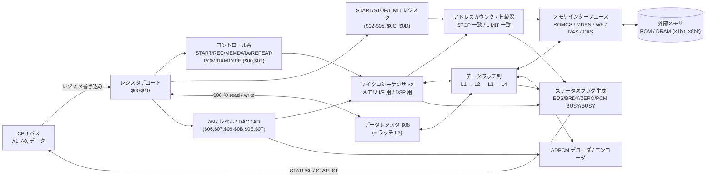
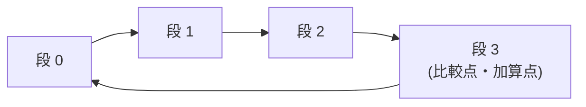
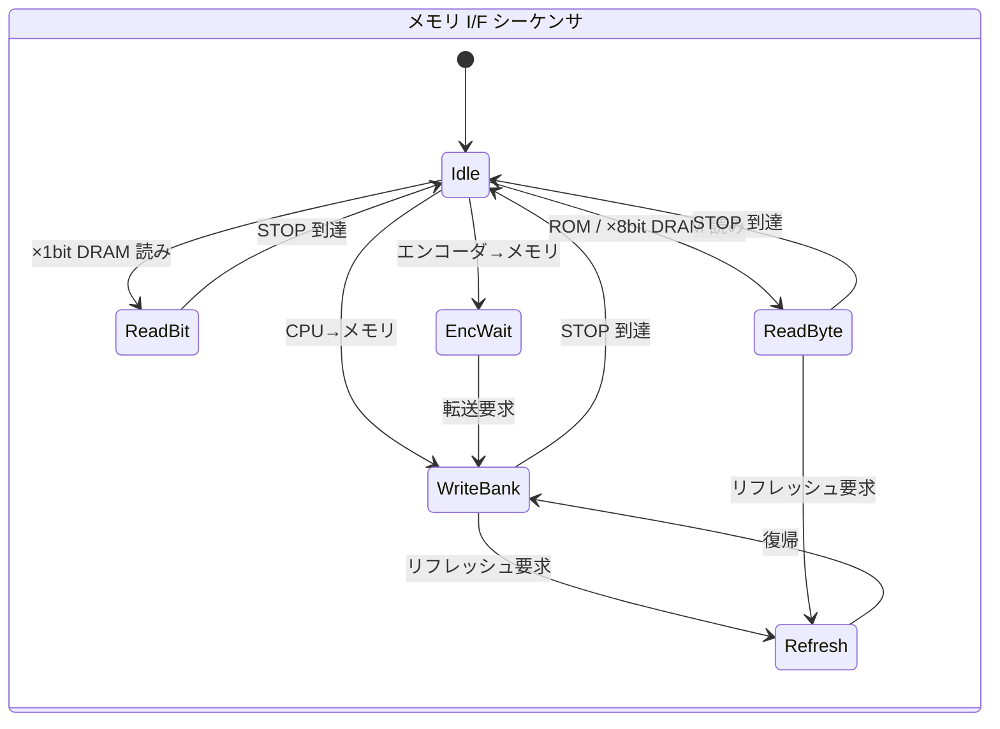

# YM2608 の内部構造

ADPCM-B (DELTA-T) 部の内部構造を、レジスタ → 内部信号 → データパス / アドレス生成 →
メモリインターフェース → ステータスフラグという繋がりで俯瞰する。

以降のドキュメントで説明する挙動のほとんどは、ここに挙げる**数個の構造から機械的に出てくる**。
個別の挙動を暗記するより、構造を先に押さえた方が早い。

根拠ラベルの意味は [01_overview.md](01_overview.md) を参照。

---

## 1. ADPCM-B レジスタ一覧

YM2608 では ADPCM-B のレジスタは**上位バンク** (A1=1 側) の `$00`〜`$10` に置かれている。
チップ全体のアドレス空間で言えば `$100`〜`$110` にあたる。
以降このドキュメント群では、上位バンク内のオフセットで `$00`〜`$10` と表記する。

### `$00` コントロールレジスタ 1

| bit | 名称 | 機能 |
|---|---|---|
| D7 | START | 実行開始。外部メモリアクセス時はこのビットが立った時から分析/合成が始まる |
| D6 | REC | 1 = 録音 (分析/書き込み方向)、0 = 再生 (合成/読み出し方向) |
| D5 | MEMDATA | 1 = 外部メモリ駆動、0 = CPU 駆動 |
| D4 | REPEAT | 1 = STOP 到達で START アドレスへ戻って繰り返す |
| D3 | SPOFF | 1 = D/A 出力を止める |
| D0 | RESET | 1 = 動作を停止し初期状態へ戻す |

`$00` の D7 は、**そのバイトを書いた時点の値がそのまま START ビットになる**。
RESET だけを立てるつもりで `$00 = $01` と書くと、同時に START を 0 にしてしまう
([06_status-flags.md](06_status-flags.md) の検証時の落とし穴)。

### `$01` コントロールレジスタ 2

| bit | 名称 | 機能 |
|---|---|---|
| D7 | L | 1 = Lch へ出力 |
| D6 | R | 1 = Rch へ出力 |
| D3 | SAMPLE | A/D 変換の開始 |
| D2 | DA/AD | D/A 変換のイネーブル |
| D1 | RAMTYPE | 1 = ×8bit DRAM、0 = ×1bit DRAM |
| D0 | ROM | 1 = ROM、0 = DRAM |

マニュアル本文は D6 と D7 の L/R を取り違えている。**ビット図の側 (D7=L / D6=R) が正しい**
([07_manual-vs-hardware.md](07_manual-vs-hardware.md))。

D1/D0 の組み合わせが転送の粒度と経路を決める。**この 2 ビットの効き方は読みと書きで非対称**で、
`11` (ROM かつ 8bit DRAM) はどの読み出し経路にも当たらない ([03_address.md](03_address.md))。

### アドレス・データ・その他

| reg | 名称 | 内容 |
|---|---|---|
| `$02` / `$03` | START ADDRESS | 開始アドレス (下位 / 上位)。16bit がアドレスの上位に入る |
| `$04` / `$05` | STOP ADDRESS | 終了アドレス (下位 / 上位) |
| `$06` / `$07` | PRESCALE | プリスケール (下位 / 上位) |
| `$08` | ADPCM DATA | CPU ⇔ 外部メモリ / デコーダのデータレジスタ。read / write 両用 |
| `$09` / `$0A` | ΔN | 再生レート (下位 / 上位) |
| `$0B` | LEVEL | 音量 |
| `$0C` / `$0D` | LIMIT ADDRESS | リミットアドレス (下位 / 上位) |
| `$0E` | DAC DATA | D/A 変換用データ |
| `$0F` | PCM DATA | PCM データ |

`$08` の 1 バイトには 4bit の ADPCM データが 2 個入る。**上位 4bit が先、下位 4bit が後**。

### `$10` FLAG コントロール

| bit | 機能 |
|---|---|
| D7 | IRQ RESET。1 で書くと D4-D0 は無視され (書き換えられず)、同時にフラグがクリアされる |
| D4 | MASK ZERO |
| D3 | MASK BRDY |
| D2 | MASK EOS |
| D1 | MASK TIMER B |
| D0 | MASK TIMER A |

マスクビットは「そのフラグを**発生させない**」。リセット後の初期値は `0x1C`
(= ZERO / BRDY / EOS がマスクされた状態) である。
マスクの意味は「読み出し時に隠す」ではなく「**発生時に破壊する**」で、
これは実装上の重要な差になる ([06_status-flags.md](06_status-flags.md))。

---

## 2. 全体ブロック図



以降の節はこの図の各ブロックを拡大したものである。

---

## 3. `$08` のデータパスは 4 段のバイトラッチ直列

ADPCM-B のデータ経路は、**4 つのバイトラッチが直列に並んだパイプライン**である [解析]。

```
外部メモリ ──▶  L1  ──▶  L2  ──▶  L3  ──▶ CPU ($08 read)
              取込     先読み    CPU 可視
                                  ▲  │
                  CPU ($08 write) ┘  └──▶  L4  ──▶ デコーダ
                                          ニブル
                                          シフタ
```

| ラッチ | 役割 |
|---|---|
| **L1** | 外部メモリピンからの取込レジスタ |
| **L2** | 先読みバッファ。×8bit / ROM では L1 を丸ごと、×1bit DRAM では 1 ビットずつ挿入して 1 バイトに組み立てる |
| **L3** | **CPU から見える `$08` レジスタそのもの。read / write 共用の透過ラッチ** |
| **L4** | デコーダ / エンコーダ側の 8bit シフトレジスタ |

この構造から次のことが直接出てくる。**どれも個別の仕様ではなく、段数の帰結である。**

- **`$08` の read は L3 の現在値を無条件に返し、write は L3 を無条件に上書きする。**
  転送モードの判定は一切入らない。「今アクセスしてよいか」というガードが存在しない。
- **ダミーリードの回数 = 経路のラッチ段数。** 外部メモリ→CPU は L2 と L3 の 2 段なので 2 回、
  エンコーダ→CPU は 1 段なので 1 回 ([04_data-register.md](04_data-register.md))。
- **先読み段を前進させているのは、メモリフェッチの完了ではなく CPU の `$08` アクセスそのもの。**
  1 アクセスにつき 1 段しか進まない。しかもこのトリガは **read と write を区別しない**。
- **ラッチはクリアされない。** ダミーリードで出てくるのは前の操作でそこに残っていた値である。
- **再生経路と CPU 経路は同じ L1〜L3 を通る。** 再生が最後にフェッチしたデータが、その後の
  `$08` read にそのまま現れる ([05_playback.md](05_playback.md))。

---

## 4. アドレスカウンタは 4 段リングを回る 21bit

アドレスカウンタは 4 段のリングシフタで、リングの 1 点が比較点かつインクリメント点になっている [解析]。
9bit 幅の比較器を 3 相で時分割再利用する構造である。



1 周は 4 フェーズだが、**実データが載るのは 3 フェーズ (9 + 9 + 3 = 21bit) だけで、
残り 1 フェーズはバブル**である。マニュアル p.48 の BANK (3bit) + CAS ADDRESS (9bit) +
RAS ADDRESS (9bit) という 21bit 構成が、そのまま回路の時分割構造として出ている。

| フェーズ | 幅 | アドレス上の位置 |
|---|---|---|
| 0 | 9bit | address[8:0] |
| 1 | — | **バブル** (比較結果は捨てられる) |
| 2 | 9bit | address[17:9] |
| 3 | 3bit | address[20:18] |

STOP / LIMIT の一致判定は、3 フェーズ分の比較結果がすべて一致したときに成立する。
**したがって実効アドレス幅は 21bit (アクセス単位)** であり、バイトアドレスに直すと
ROM / ×8bit DRAM で 21bit、×1bit DRAM で 18bit になる ([03_address.md](03_address.md))。

---

## 5. マイクロシーケンサは 2 本ある

ADPCM-B の動作を刻んでいるマイクロシーケンサは 1 本ではなく **2 本ある** [解析]。
両者は独立したプログラムカウンタと制御語を持つ。

| シーケンサ | 役割 |
|---|---|
| **メモリ I/F シーケンサ** | 外部メモリの RAS / CAS / WE サイクルを刻む。ラッチ列 L1→L2→L3 の転送とアドレスカウンタの更新を駆動する |
| **DSP シーケンサ** | ADPCM の予測値・量子化幅の演算を刻む。L4 からニブルを取り出してデコードする |



メモリ I/F シーケンサはバンク構成になっている
(書き込み / ×1bit 読み / バイト読み / エンコーダ待機 / リフレッシュ / アイドル)。
ここに**本ドキュメント群で最も重要な構造**がある。

> **転送バンクのディスパッチは、シーケンサがアイドルにいるときにしか起きない。**
> そしてアイドルへ落ちるのは **STOP に到達したとき**か、**RESET ビット / IC が入ったとき**だけである。

この 1 点から、次のような一見ばらばらな挙動がすべて説明できる。

- `$00` のモードだけを書き換えても、シーケンサは元のバンクに居座り続ける
  (書き込みバンクに居座ったまま「read」するとメモリを破壊し続ける)
  → [04_data-register.md](04_data-register.md)
- START アドレスのロードは `$00` を書いた時ではなく、最初のアクセスが始まる時に起きる
  → [03_address.md](03_address.md)
- REPEAT の折り返しは、書き込み中であっても読み出しバンクで再ディスパッチされる
  (これが「REPEAT=1 のまま `$08` へ書くと STOP 到達後に書けなくなる」の正体)
  → [03_address.md](03_address.md)

DSP シーケンサ側は、録音 (エンコード) 用と再生 (デコード) 用の 2 つのプログラム空間を持ち、
`$00` の REC ビットで切り替える。起動時には共通のプロローグを通り、**そこで内部レジスタが
初期化される**。このプロローグは**新規 START と REPEAT の再始動を区別しない**ため、
REPEAT 再生ではループごとにデコーダ状態が完全にリセットされる ([03_address.md](03_address.md))。

---

## 6. DRAM リフレッシュはサブルーチンとして割り込む

メモリ I/F シーケンサは、転送の合間に **DRAM リフレッシュのルーチンへ分岐し、
退避したプログラムカウンタへ復帰する**というサブルーチン機構を持つ [解析]。

重要なのは次の 2 点である。

- **リフレッシュは実効アドレスを進めない。** 迂回中にもリング内部は回るが、比較と出力に
  使われる段の値は変化しない。
- **迂回中は STOP / LIMIT の比較フェーズも進まない。**

したがって**リフレッシュは CPU から見た転送データ列に一切現れない**。
エミュレータがリフレッシュを模擬する必要は無い。

---

## 7. 転送モードの一覧

`$00` の START / REC / MEMDATA と `$01` のメモリ種別の組み合わせが、
データの通る経路そのものを決めている [解析]。

| 経路 | START | MEMDATA | REC | メモリ種別 | `$00` | マニュアルの手順 |
|---|---|---|---|---|---|---|
| CPU → メモリ | 0 | 1 | 1 | — | `$60` | RAM-WRITE (p.53) |
| メモリ → CPU (ROM) | 0 | 1 | 0 | ROM=1, RAMTYPE=0 | `$20` | RAM/ROM-READ (p.53) |
| メモリ → CPU (×8bit DRAM) | 0 | 1 | 0 | ROM=0, RAMTYPE=1 | `$20` | 同上 |
| メモリ → CPU (×1bit DRAM) | 0 | 1 | 0 | ROM=0, RAMTYPE=0 | `$20` | 同上 |
| メモリ → デコーダ (通常再生) | 1 | 1 | 0 | — | `$A0` / `$B0` | 音声合成・外部メモリ (p.54) |
| CPU → デコーダ | 1 | 0 | 0 | — | `$80` | 音声合成・CPU (p.55) |
| エンコーダ → メモリ | 1 | 1 | 1 | — | `$E8` | 音声分析・外部メモリ (p.54) |
| エンコーダ → CPU | 1 | 0 | 1 | — | `$C8` | 音声分析・CPU (p.55) |

これとは別に、**転送の終了を検出する条件**が独立して存在する。これは経路ではなく
「転送が終わった / 止まった」の判定で、EOS の発生とラッチのクリアを起こす。
CPU 駆動モード (`$00 = $80`) で START を落としたときの終了も、この経路が受け持っている。

表から読み取れる構造上の性質を 2 つ挙げておく。

- **START ビットが CPU 主導 / DSP 主導のセレクタになっている。**
  CPU が `$08` で叩く経路はすべて START=0 側、DSP 主導の経路はすべて START=1 側にある。
- **マニュアル p.53-56 の 6 つの手順表は、この経路分類とそのまま 1 対 1 に対応する。**
  表の区切り方 (RAM-WRITE / RAM・ROM-READ = メモリ I/F のみ、音声分析/合成・CPU = DSP のみ、
  音声分析/合成・外部メモリ = 両方) が、ハードウェアの構成をそのまま反映している。

### 表に無い組み合わせ

**上の表に無い REC / MEMDATA の組み合わせには、対応する経路が存在しない。**
このとき外部メモリのシーケンサは一切起動しないが、**ラッチ列と先読み段だけは進む**という
中間状態になる。CPU からは「1 バイト目だけ値が返り、以降 BRDY が 0 に張り付く」という形で
観測できる ([04_data-register.md](04_data-register.md))。

同様に、メモリ種別の `11` (ROM かつ RAMTYPE=1) は読み出し・再生のどの経路にも当たらない。
マニュアルの手順表にもこの組み合わせは一度も現れない ([03_address.md](03_address.md))。

---

## 8. クロックとニブルレート

ADPCM-B のクロックは**マスタクロック / 144** である。7.9872MHz の場合は 55466Hz になる。
このクロックごとに ΔN を 16bit アキュムレータへ加算し、繰り上がった回数だけニブルを消費する。

```
ニブルレート [Hz]              = ΔN / 65536 × 55466
1 ニブルあたりのマスタクロック  = 65536 / ΔN × 144
```

例として ΔN = 512 では:

| 単位 | 時間 |
|---|---|
| 1 ニブル | 2.3077 ms (433.33 ニブル/秒) |
| 1 バイト (2 ニブル) | 4.6154 ms |
| 32 バイト (64 ニブル) | 147.7 ms |

再生時のフェッチ周期や EOS の位置は、この換算を通して時間で検証されている
([05_playback.md](05_playback.md))。
